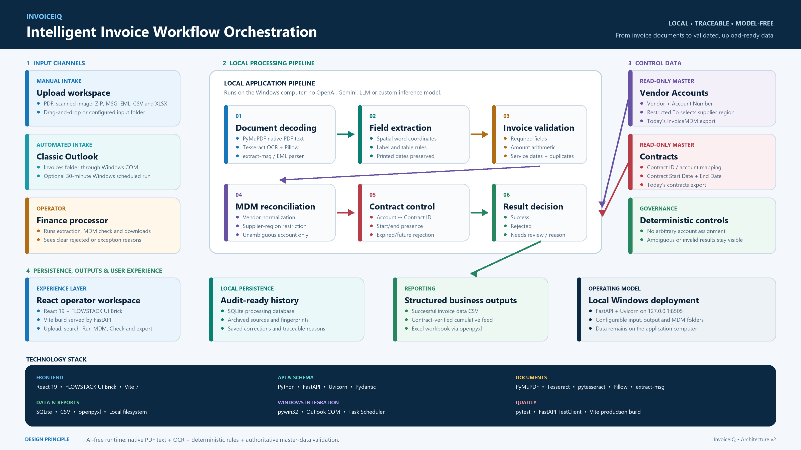

# Intelligent Invoice Workflow Orchestration

Automating invoice intake, document extraction, MDM reconciliation, contract checks and cumulative reporting in one local application.

The active application uses native PDF text, Tesseract OCR and deterministic
parsing/validation rules. It does not load invoice `.joblib` artifacts, call
Ollama/LLMs or train models when corrections are saved. Existing columns are
unchanged. Extracted invoice dates are displayed/exported exactly as printed.
Historical model experiments are optional developer tools only.



[Architecture](docs/architecture/solution-architecture.md) · [Submission](SUBMISSION.md) · [Training evaluation](TRAINING_2000_REPORT.md)

## Team Information

| Field | Details |
| --- | --- |
| Team Name | To be confirmed |
| Stream | To be confirmed |
| Department | To be confirmed |
| Problem Statement | Intelligent Invoice Workflow Orchestration |
| Team Lead | To be confirmed |
| Team Members | To be confirmed |

## Problem Statement

Invoice operations required staff to locate emails, download attachments, transcribe invoice fields, search Vendor Accounts, verify contracts and maintain spreadsheets. Each handoff repeated work and made errors, duplicate handling and delayed processing harder to detect.

The business objective is to connect those steps into a repeatable workflow. Operators should receive structured invoice results and clear exceptions, with account selection traceable to the MDM reference record.

## Proposed Solution

The application combines manual uploads and classic Outlook intake with local document extraction, validation and reporting.

**Workflow:** Receive → Extract → Validate → Match vendor and account → Check contract dates → Save and export.

Finance processors and operations teams use one interface to process invoices, review exceptions and download reports. MDM and contract reviewers can inspect the matching reasons and rerun reconciliation after updating reference data.

The solution runs on a local Windows computer. Its main differentiators are local processing, account selection from an authoritative master, spatial table reading and explicit validation. Expected savings and field accuracy require measurement on representative invoices.

## Key Features

| Capability | Behavior |
| --- | --- |
| Invoice intake | Manual PDF, image, ZIP, MSG, EML, CSV and XLSX uploads; classic Outlook `Invoices` folder intake |
| Document extraction | Native PDF text or Tesseract OCR, followed by spatial table and invoice-field parsing |
| Invoice validation | Required-field, amount, service-line and duplicate checks |
| Billing Account matching | Normalized vendor comparison; Region is used when multiple accounts match one vendor |
| MDM vendor naming | Vendor -As per MDM uses the matched Vendor Accounts record's Vendor name; the original extracted name remains in source history |
| Contract verification | Billing Account is matched to Contract ID; one record must have usable start and end dates |
| Exception handling | Review reasons identify missing, inconsistent, duplicate or unresolved results |
| Cumulative reporting | All saved results feed invoice history; eligible results enter a second contract-verified export |
| Saved corrections | Verified corrections and source history are retained; no model is trained or loaded |

## Solution Architecture

The November extraction hardening work is described in
[the extraction verification report](docs/extraction-hardening.md), including
the Kaggle sample, unresolved date handling, and remaining verification needs.

The [architecture document](docs/architecture/solution-architecture.md) explains component responsibilities and decision rules. The [PNG](docs/architecture/top-level-architecture.png) is suitable for presentations.

| Layer | Responsibility |
| --- | --- |
| Operator workspace | React/FLOWSTACK interface for upload, Run Outlook, review, Run MDM and downloads |
| Processing services | FastAPI coordinates intake, local extraction, validation and reconciliation |
| Reference data | Vendor Accounts and Contracts CSV masters supply account and contract information |
| Persistence | SQLite stores batches and review history; source documents are archived locally |
| Reporting | Cumulative CSV files and an Excel workbook are regenerated from saved history |

The workflow reads MDM masters and writes Billing Account into invoice output. It does not update the Vendor Accounts or Contracts master records.

## Technology Stack

| Area | Components |
| --- | --- |
| Frontend | React 19.2.0, FLOWSTACK UI Brick 0.2.2, Vite 7.1.7 |
| Backend | Python, FastAPI, Uvicorn, Pydantic |
| Database | SQLite |
| Extraction | Local Tesseract OCR and deterministic invoice parsers; no separate inference model |
| Document handling | PyMuPDF, Tesseract/pytesseract, Pillow, extract-msg, openpyxl |
| APIs and integrations | Local FastAPI API, classic Outlook desktop object model through pywin32 |
| Deployment | Windows, loopback web service, optional per-user scheduled task |
| Testing | pytest, API tests, frontend production build |

## Suggested Repository Structure

The project uses the following structure:

```text
invoice_ai/
|-- config/                 Settings and ignored runtime data
|-- docs/architecture/      Architecture PNG and documentation
|-- evaluation/             Offline evaluation utilities
|-- frontend/               React interface
|-- models/                 Invoice data schemas
|-- scripts/                Setup, scheduler and documentation utilities
|-- services/               Intake, extraction, MDM, validation and storage
|-- tests/                  Automated application tests
|-- training/               Local model training and verification
|-- utils/                  Shared helpers
|-- .env.example            Configuration template
|-- requirements.txt        Runtime dependencies
|-- requirements-dev.txt    Testing dependencies
|-- SUBMISSION.md           Business submission
|-- README.md               Setup and project overview
`-- web_app.py              Application entry point
```

## Setup and Execution

### Prerequisites

Use Python, Node.js/npm and Tesseract installed through approved channels. Classic Outlook on Windows is needed for desktop mailbox intake. Supply your own authorized Vendor Accounts and Contracts masters for reconciliation.

### Installation

From the project directory:

```powershell
py -m venv .venv
.\.venv\Scripts\python.exe -m pip install -r requirements.txt
cd frontend
npm ci
npm run build
cd ..
```

### Configuration

Copy `.env.example` to `.env` when configuration changes are needed. Set:

- `TESSERACT_CMD`: Tesseract executable path if it is absent from PATH.
- `LOCAL_STORAGE_DIR`: local persistence folder; the default is `config/local_data`.
- `OUTLOOK_MAILBOX`: exact mailbox name when several mailboxes contain an Invoices folder.
- `OUTLOOK_INVOICE_FOLDER`: folder name, default `Invoices`.

Place `vendor_accounts.csv` and `contracts.csv` together in the configured storage folder's `MDM` directory. The application also supports the existing project `local_data/MDM` location. The configured storage master takes precedence when present.

No invoice model artifact is needed to run the application. Private MDM files
remain outside the repository. The old [training report](TRAINING_2000_REPORT.md)
describes historical experiments, not the active extraction backend.

### Run

```powershell
.\.venv\Scripts\python.exe -m uvicorn web_app:app --host 127.0.0.1 --port 8505
```

Open [the local application](http://127.0.0.1:8505/). For frontend development, use backend port 8502 with `npm run dev`; Vite's development API proxy targets port 8502.

### Editable locations in Settings

Open **Settings** in the app, paste absolute folder paths on the computer running the backend, and select **Save settings**. Settings persist across app restarts; no edits to Codex's `config.toml` are required.

- **Invoice input folder:** optional. Leave blank for manual drag-and-drop uploads. Set it to read files using **Run input folder**. PDF, images, MSG/EML attachments, ZIP, CSV and XLSX use the same upload pipeline. Folder runs scan the top level only, process at most 100 new source files per run, skip successfully saved file versions, and keep original input files untouched. Files that failed can be retried; changing a file's content makes it a new version. Manual uploads and Outlook still work.
- **Output folder:** cumulative CSV/Excel exports go here, including `MDM/Invoice_data.csv` and `MDM/Contract_verified_invoices.csv`. Changing this folder regenerates exports from existing history without moving or deleting history, reviewed examples or model artifacts. Previous export copies are kept; only the active output folder is updated thereafter.
- **Master Excel filename:** a simple `.xlsx` filename, default `Invoice_History.xlsx`.
- **MDM folder:** contains the current Vendor Accounts and Contracts exports. The Vendor Accounts filename may otherwise vary; it must contain both `InvoiceMDM` and today's `YYYYMMDD` in India time. The Contracts filename must contain `contracts` and today's `YYYYMMDD`. For example, `anything_InvoiceMDM_anything_20261007_anything.csv` and `anything_contracts_anything_20261007_anything.csv` qualify on 7 October 2026. Billing Account is read from the Vendor Accounts `Account Number` column (`Account` remains supported for older masters). Older dated exports are ignored. Legacy `vendor_accounts.csv`/`.xlsx` and `contracts.csv`/`.xlsx` names remain supported when no corresponding dated exports exist. Keep only one current export for each master. The first worksheet is used for XLSX; account codes with leading zeros must be stored as text. The masters are read-only. An explicitly selected folder never silently falls back to a different master.
- **Review threshold and rounding tolerance:** saved for subsequent runs, including scheduled Outlook processing. The review threshold is configurable from 1–100%; confidence is not an accuracy measurement, and lowering the threshold does not bypass missing service dates or other validation rules.

The processing database is intentionally **not a UI field**. It stays in the existing internal local-data directory alongside training history. Settings are stored in that directory's ignored `ui_settings.json`; no API key or remote-model control is included. Reset clears saved invoice rows, archived upload copies and active report rows while preserving settings, training, MDM masters, and original files in the configured external input folder.

### Outlook intake

Keep classic Outlook open under the same Windows user and select **Run Outlook**. Supported non-inline attachments enter the shared extraction pipeline. Successfully saved emails are marked read, and previously saved message versions are skipped.

To enable the optional recurring task:

```powershell
.\scripts\install_outlook_schedule.ps1
```

The task runs every 30 minutes while the user is signed in and Outlook is open, with up to 100 new messages per pass. Manual uploads remain available.

### Hosted interface with local Outlook

The optional Cloudflare Pages build hosts only the React interface. The Python API, classic Outlook access, OCR, SQLite history, MDM masters, uploads, and generated reports continue to run on the Windows computer using the app. Start the local service on `127.0.0.1:8505` as above and keep it running while using the hosted interface.

Build the separate upload package with `cd frontend; npm run build:hosted`. Upload only the contents of `frontend/dist-hosted` to a Cloudflare Pages Direct Upload project. Do not upload the Python project, `.env`, `config/local_data`, MDM masters, model files, or invoices.

On the Windows computer, create `config/local_data/hosted_ui_origin.txt` containing the exact HTTPS origin of the deployed `*.pages.dev` site, for example `https://invoice-iq-local.pages.dev`, with no path. Restart the local service after installing this code. Open the hosted page in a browser on the same computer and select **Connect this computer**. A local window pairs that browser tab with this computer. If Chrome requests local network access, allow it for this site. Pairing lasts for the browser tab's session; **Disconnect** clears it.

The local service remains bound to loopback. Cross-origin API requests require both the configured Pages origin and a randomly generated local key, saved in ignored `config/local_data/hosted_ui_token.txt`. The key is delivered only to that origin through a local browser window and is never included in the hosted build. The hosted interface cannot process documents while the local service is closed or when opened on a computer that does not run the local app. Keep access to this hosted site and local computer limited to authorized users.

### Outputs and field rules

| Report | Contents |
| --- | --- |
| `MDM/Invoice_data.csv` | All saved invoice results with the 16 current business columns |
| `MDM/Contract_verified_invoices.csv` | Eligible successful records with matched contract dates; 13 columns and `Insert` marker |
| `Invoice_Data.csv` | Detailed invoice results |
| `Invoice_Line_Items.csv` | Parsed service descriptions, quantities, rates and amounts |
| `Audit_Report.csv` | Processing and review evidence |
| `Invoice_History.xlsx` | Cumulative workbook including MDM Invoice Data and Contract Verified sheets |

Billing dates come from invoice service dates. Received and scanning dates use the local processing date. Invoice ageing is today's date minus invoice date. Region uses the vendor location, with explicitly labelled email Region available as a fallback. Source email comes from an address printed on the invoice.

Vendor -As per MDM uses the exact Vendor spelling/capitalization from the resolved Vendor Accounts record, not the extracted invoice name. Matching supports distinctive multiword shortened master names and a single-character OCR typo; full/exact names take priority. For multiple matching accounts, Region must resolve the correct Restricted To record. Ambiguous matches keep the original extracted name and require review instead of selecting an arbitrary vendor/account.

The matcher takes invoice and MDM names as runtime inputs; there is no hard-coded company-name list. Adding a vendor to Vendor Accounts does not require changing Python code. Named companies in `tests/test_vendor_matching.py` are test examples only, supplemented by generated names of varying lengths and checks that weak or ambiguous matches are not accepted. Unrelated abbreviations or uncertain OCR may still need a master alias or human review.

Both Billing Start Date and Billing End Date are mandatory service dates. If either is missing, the invoice is **Rejected**, even when extraction confidence is high or MDM and contract checks pass. The UI shows a separate Rejected count and filter. The cumulative invoice CSV/Excel and audit retain the rejected record with its missing-date reason; the contract-verified feed excludes it. This rule also applies when older saved reports are refreshed. Correcting both service dates reruns normal validation; invoice or contract dates are never substituted for missing service dates.

After upload, invoice-extracted fields are saved while Billing Account and contract-check fields stay blank. **Run MDM** matches the saved batch against current Vendor Accounts and Contracts files, fills those fields, and refreshes exports. **Check** then performs a read-only recheck and displays per-invoice account and contract outcomes. **Reset** clears uploaded sources and saved invoice rows after two confirmations, then creates empty reports with headers. Reviewed training examples and model artifacts are retained.

## Testing

```powershell
.\.venv\Scripts\python.exe -m pip install -r requirements-dev.txt
.\.venv\Scripts\python.exe -m pytest -q
cd frontend
npm run build
```

Tests cover intake, email attachments, extraction, MDM matching, contract exports, review, persistence, reset, scheduling and APIs. Use isolated synthetic data for tests and confirm Outlook access separately on the deployment computer.

A successful processing status means the pipeline ran. Success / No Review Required means the configured checks passed. Extraction completeness measures field coverage, not verified accuracy. OCR/rule checks do not guarantee every extracted value is correct.

## Security and Compliance

Invoice extraction runs locally. The web service is configured for loopback access, and MDM masters are read-only. Use approved dependency sources and access-controlled storage. Credentials, invoice files, local history, training data and model artifacts must remain outside the source repository. Reviewed examples still contain invoice information after reset and need an appropriate retention policy.

## Business Impact

| Outcome | How the workflow contributes |
| --- | --- |
| Time saved | Automates attachment intake, transcription, reference lookup and consolidation |
| Cost reduction | Reduces repetitive handling where extraction and validation succeed |
| Risk reduction | Exposes duplicates, inconsistencies and ambiguous account selections |
| User experience | Provides one processing, review and download workspace |
| Standardization | Applies the same rules to manual uploads and Outlook attachments |
| Scalability | Supports batch processing and recurring intake; target-machine throughput needs measurement |

A pilot should measure handling time, correction effort, field-level accuracy, account-match accuracy and review rate before assigning quantified savings.

## Demo and Presentation

- Application/demo URL: [local application](http://127.0.0.1:8505/) on the running computer.
- Architecture: [presentation PNG](docs/architecture/top-level-architecture.png).
- Demo recording and presentation links: To be provided.
- Demo sequence: intake → extraction → MDM match → contract check → exception review → cumulative download.

## Final Submission

Use [SUBMISSION.md](SUBMISSION.md) for the executive summary, business case, architecture, limitations and submission checklist. Complete the team details and demo links before submission.

## Support

Use the repository's issue tracker for technical problems and the internal organizing team for submission questions. Include the sanitized error, source format and reproduction steps.
