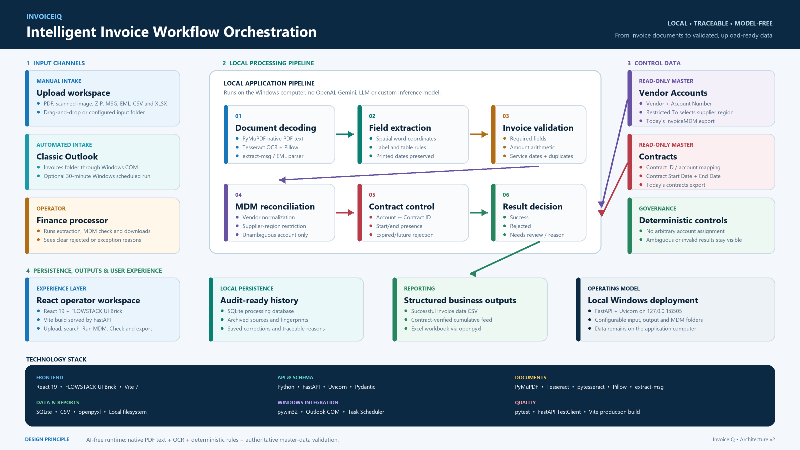

# Intelligent Invoice Workflow Orchestration

## Executive Summary

We built a local application that connects invoice receipt, document extraction, MDM reconciliation, contract checks and reporting. Finance and operations teams can process attachments from classic Outlook or manual uploads, inspect extracted values, resolve exceptions and download cumulative outputs from one workspace.

The business problem is the repeated manual handling between these steps. The solution automates routine processing and makes unresolved cases visible with specific review reasons. Its current scope is a working local prototype. Extraction accuracy and financial savings should be established through a representative pilot.

## Business Problem

The previous workflow required an operator to find emails, download invoices, read documents, transcribe fields, search Vendor Accounts, select a Billing Account, check contract records and update spreadsheets. Each step depended on manual attention and repeated information entry.

At high volumes, this creates processing delays, transcription errors, duplicate handling and inconsistent reference checks. Invoice processors, MDM reviewers, contract reviewers and downstream reporting teams all depend on the quality of these handoffs.

The objective is to automate the sequence while retaining traceable decisions and human review for missing, conflicting or ambiguous information.

## Proposed Solution

A shared local pipeline receives documents from manual uploads or the classic Outlook `Invoices` folder. It reads native PDF text or runs OCR, selects invoice fields with a supervised Python model, parses service lines and validates the result.

The application then matches the vendor to Vendor Accounts. Region is compared with `Restricted To` when multiple accounts match that vendor. A uniquely selected Account is written to the invoice's Billing Account field. The related contract is checked for a unique record with usable Start Date and End Date.

Results are saved to SQLite history and cumulative CSV/Excel reports. Operators can correct exceptions, refresh MDM matches and download outputs. Reviewed corrections become local training examples. An optional Windows scheduled task repeats Outlook intake every 30 minutes.

The workflow reads the MDM masters and updates invoice outputs. Master-data maintenance remains a separate business responsibility.

## Key Features

1. Intake from PDFs, images, archives, saved emails and spreadsheets, plus classic Outlook attachment retrieval.
2. Local PDF text extraction, OCR, supervised field selection and service-line parsing.
3. Required-field, amount, line-item and duplicate validation with explicit review reasons.
4. Vendor normalization and region-based account selection where one vendor has several accounts.
5. Contract date checks and a separate cumulative export for eligible results.
6. Human correction, audit history and local training from reviewed examples.
7. Cumulative persistence and report reset that retains training artifacts.

## Architecture



[Detailed architecture and decision rules](docs/architecture/solution-architecture.md)

The five main stages are **Invoice intake → Local extraction → Invoice validation → MDM reconciliation → Save and export**. The operator workspace controls processing and review. MDM reference files supply the business match. Exceptions enter a correction loop, and reviewed examples support local model retraining.

| Component | Role |
| --- | --- |
| Operator workspace | React/FLOWSTACK interface for upload, Outlook Run, review, Run MDM and downloads |
| Processing service | FastAPI and Python services coordinate intake, extraction and checks |
| Reference masters | Vendor Accounts selects Billing Account; Contracts supplies contract dates |
| Review and learning | Operators resolve exceptions and save reviewed labels for local training |
| Persistence and reporting | SQLite and source archives preserve results; CSV/Excel files accumulate output |

All components execute on the local Windows computer. Reference masters are read without modification.

## Technology Stack

| Layer | Technology |
| --- | --- |
| Frontend | React 19.2.0, FLOWSTACK UI Brick 0.2.2, Vite 7.1.7 |
| Backend | Python, FastAPI, Uvicorn, Pydantic |
| Database | SQLite |
| AI/ML | scikit-learn logistic regression, local invoice parsers, joblib |
| Document extraction | PyMuPDF, Tesseract/pytesseract, Pillow, extract-msg |
| Spreadsheet support | openpyxl and CSV exports |
| APIs and integrations | Local FastAPI API, classic Outlook object model through pywin32 |
| Deployment | Loopback web service on Windows; optional scheduled task |
| Testing | pytest, API tests and frontend build |

## Setup and Execution

The [README setup instructions](README.md#setup-and-execution) cover prerequisites, installation, configuration, runtime commands, Outlook intake and report locations.

The local demo can be started from the project directory after installing requirements and building the frontend:

```powershell
.\.venv\Scripts\python.exe -m uvicorn web_app:app --host 127.0.0.1 --port 8505
```

Open `http://127.0.0.1:8505/` on that computer. A new installation requires authorized MDM reference files and a locally trained model artifact for model-based field selection. These private runtime assets are excluded from the source repository.

## Demo

| Item | Status |
| --- | --- |
| Application URL | `http://127.0.0.1:8505/`, accessible on the running computer |
| Architecture diagram | [Top-level PNG](docs/architecture/top-level-architecture.png) |
| Demo video | To be provided |
| Presentation | To be provided |

Demonstrate one approved synthetic invoice from intake through extraction, account matching, contract checks and cumulative reporting. Include an ambiguous or incomplete case to show its review reason and correction flow.

## Business Benefits

| Benefit | Expected contribution | Pilot measurement |
| --- | --- | --- |
| Time saved | Fewer downloads, manual entries and spreadsheet handoffs | Minutes per invoice, including correction time |
| Cost reduction | Less repetitive processing effort | Handling hours and approved cost assumptions |
| Risk reduction | Visible duplicate, validation and reference-data exceptions | Error rate, duplicate detection and wrong-account rate |
| User experience | One processing and review workspace | User task completion and feedback |
| Process standardization | Consistent checks across intake sources | Review reasons and reconciliation outcomes |
| Scalability | Batch processing and recurring intake | Invoices per hour and backlog on the target machine |

These are expected benefits; no measured ROI or production-wide accuracy is claimed. The intended extraction target is at least 90% across important invoice fields, to be evaluated against independently labelled invoices.

## Responsible AI and Security

Document extraction and model inference run locally. The application exposes specific review reasons and supports human corrections. It does not use unreviewed predictions as training labels.

A processing Success indicates completion of the pipeline; No Review Required indicates that configured checks passed. Extraction completeness measures populated fields. Neither is a calibrated accuracy score.

The service runs on loopback. Invoice sources, history, reviewed examples and model artifacts require appropriate local access controls, backups and retention. Only authorized data should enter the workflow or demonstration. Runtime credentials and private data are excluded from the source repository. Dependency licensing and deployment approval remain part of the organization's review.

## Limitations and Assumptions

- The local model is a supervised field selector supported by OCR and parsers. Document quality and unfamiliar layouts affect extraction.
- Business Unit and Owner remain blank until an authoritative mapping is available.
- Billing Account is selected from Vendor Accounts. Unmatched vendors, conflicting regions and multiple valid accounts are flagged; no arbitrary account is assigned.
- Contract verification checks a unique record with usable Start Date and End Date. It does not compare the invoice service period against the contract period.
- Billing Start Date and Billing End Date are invoice service dates. Received and scanning dates use the local processing date.
- The contract-verified feed requires successful validated extraction, an account match and present contract dates. `Insert` is an export marker rather than a transaction in another system.
- Outlook intake requires classic Outlook, a signed-in Windows user and permitted programmatic access. The recurring task processes up to 100 new messages per pass.
- A local URL is accessible on the running machine. Shared enterprise deployment and downstream system writes are outside the current implementation.

## Future Scope

Use a representative, authorized evaluation set to measure extraction and account-match accuracy, correction effort and throughput. Expand training coverage from reviewed examples, calibrate field confidence and refine review criteria using those measurements.

Later enhancements can add governed Business Unit and Owner mappings, service-period checks against contract validity, monitored processing queues and an approved downstream import. Enterprise deployment should include suitable identity, access and retention controls.

## Open Source and Third Party Inventory

Runtime declarations are in [requirements.txt](requirements.txt), development declarations in [requirements-dev.txt](requirements-dev.txt), and frontend dependencies in [frontend/package.json](frontend/package.json). The frontend lockfile records resolved package versions.

| Component | Declared version | Purpose | Source/registry | License | Approval/notes |
| --- | --- | --- | --- | --- | --- |
| Pydantic | >=2.0,<3 | Schemas and validation | Python registry | Review required | Runtime |
| python-dotenv | >=1.0,<2 | Configuration | Python registry | Review required | Runtime |
| PyMuPDF | >=1.24,<2 | PDF text extraction | Python registry | Review required | Runtime |
| pytesseract | >=0.3.13,<1 | OCR wrapper | Python registry | Review required | Requires Tesseract |
| Pillow | >=10.4,<12 | Image handling | Python registry | Review required | Runtime |
| extract-msg | >=0.55,<0.57 | Outlook file parsing | Python registry | Review required | Runtime |
| openpyxl | >=3.1.5,<4 | XLSX input/output | Python registry | Review required | Runtime |
| FastAPI | >=0.115,<1 | Local API | Python registry | Review required | Runtime |
| Uvicorn | >=0.30,<1 | Local server | Python registry | Review required | Runtime |
| python-multipart | >=0.0.9,<1 | File uploads | Python registry | Review required | Runtime |
| scikit-learn | >=1.7,<2 | Local supervised model | Python registry | Review required | Runtime |
| joblib | >=1.5,<2 | Model serialization | Python registry | Review required | Trusted local models |
| pywin32 | 312 on Windows | Outlook access | Python registry | Review required | Windows only |
| React / React DOM | 19.2.0 | Frontend | npm registry | Review required | Runtime |
| FLOWSTACK UI Brick | 0.2.2 | UI components | npm registry | Review required | Runtime |
| Vite | 7.1.7 | Frontend build | npm registry | Review required | Development |
| Tesseract | Separate installation | OCR engine | Approved installer | Review required | Check installed version |

License verification and corporate approval are pending review, rather than inferred from package availability. Development and transitive dependencies must also be included in the deployment inventory.

## Final Submission Checklist

- [ ] Complete team details in README.md.
- [ ] Confirm the app starts on the submission computer.
- [ ] Run Python tests and the frontend build on the submitted revision.
- [ ] Confirm architecture and documentation match the current workflow.
- [ ] Add reviewer-accessible demo recording and presentation links.
- [ ] Confirm the repository contains current source and authorized materials only.
- [ ] Complete dependency, licensing, data-handling and deployment review.
- [ ] Record representative pilot measurements before presenting accuracy or savings as achieved.
