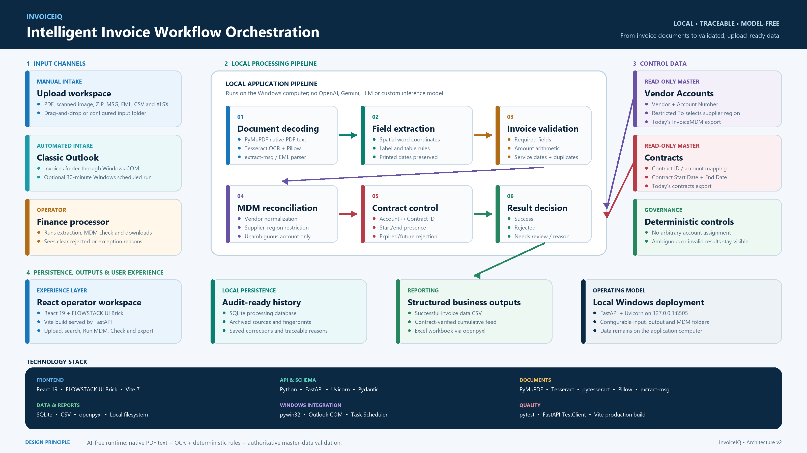
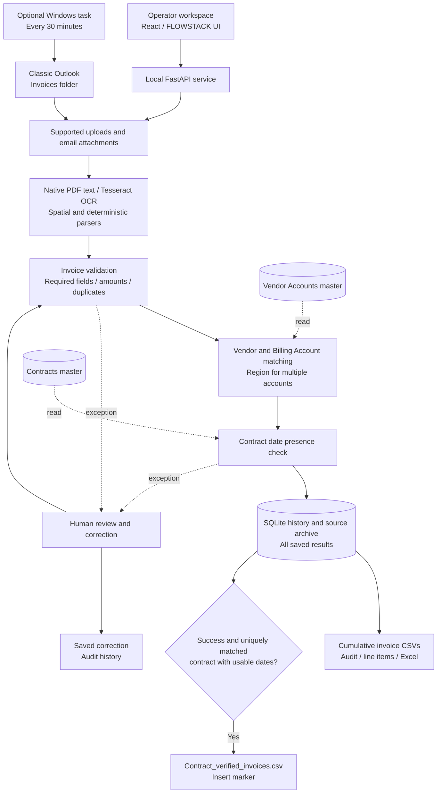

# Intelligent Invoice Workflow Architecture

[Download the presentation PNG](top-level-architecture.png) · [README](../../README.md) · [Submission](../../SUBMISSION.md)

## System overview

The application coordinates five stages on a local Windows computer:

1. **Invoice intake:** supported documents come from uploads or attachments in classic Outlook's Invoices folder.
2. **Local extraction:** native PDF text or Tesseract OCR supplies spatial words to deterministic invoice, table and service-period parsers.
3. **Invoice validation:** missing service start or end dates reject the invoice. Other required-field, amount, line-item and duplicate checks establish extraction eligibility or require review.
4. **MDM reconciliation:** vendor matching resolves Billing Account; a linked contract is checked for usable dates.
5. **Save and export:** SQLite preserves results and cumulative CSV/Excel reports are rebuilt from saved history.

The operator workspace starts processing, presents review reasons, accepts corrections and provides downloads. Corrections are retained as audit history; the active application does not train or load an extraction model.

## Component relationships

## MDM decision rules

Match the invoice vendor against normalized Vendor Accounts names, giving exact names priority before suffix-insensitive and conservative partial/fuzzy matches. Invoice number does not select an account.

A shortened master name can match a complete distinctive leading sequence of at least two non-generic words. A single-character OCR substitution, insertion or deletion is supported in that sequence or a full business name; exact/full names retain priority. Thus an invoice name such as `Blur OCean Technologies LLC` can resolve to `Blue ocean` without a hard-coded vendor mapping. Multiple matching accounts still require an unambiguous region match; one common word, missing/contradictory regions, or multiple valid accounts cannot force a match.

A single reliable vendor/account match resolves Billing Account directly. When multiple accounts match that vendor, compare the invoice Region with Restricted To. Use explicitly labelled email Region only as a fallback when invoice Region is absent; conflicts require review.

Assign the Account value only when the match is unambiguous. Unmatched vendors, no matching region or multiple remaining accounts keep Billing Account blank and expose a reason. Run MDM rechecks saved results against the current reference files without adding new invoice rows.

For a resolved match, Vendor -As per MDM uses the Vendor name from that same Vendor Accounts record, including its canonical spelling. The original extracted vendor name remains unchanged in invoice history. Unresolved matches retain the extracted name for review rather than adopting an arbitrary master name.

## Contract and export rules

Missing Billing Start Date or Billing End Date produces `REJECTED` and an explicit missing-service-date reason. Rejection takes precedence over draft, import, duplicate and review states, including old saved results during report regeneration. Rejected records remain in the cumulative invoice and audit reports but cannot enter the contract-verified feed. Human correction must supply both service dates before normal validation can accept the invoice.

After account resolution, match Billing Account to Contract ID. Require a unique record with usable Start Date and End Date. Missing or unusable contract dates trigger review and the comment `Contract is not valid` where applicable. Service-period coverage within the contract is not currently checked.

The primary MDM invoice report contains the 16 current business columns for all saved invoice results. The second feed contains 13 columns and includes only eligible successful invoices with matched contract dates. Its Insert or Update column is `Insert`; Start Date and End Date are invoice service dates.

## Data ownership and deployment

| Asset | Behavior |
| --- | --- |
| Vendor Accounts and Contracts | Read-only reference masters; no automatic master updates |
| SQLite and archived sources | Local cumulative history and provenance |
| Invoice CSV and Excel outputs | Rebuilt from saved history after processing or refresh |
| Reviewed corrections | Retained locally for audit history; no model training or inference occurs |
| Web service | Loopback endpoint on the running computer |
| Outlook scheduled intake | Per-user Windows task; Outlook must be open |

The application uses native PDF text, local Tesseract OCR and deterministic parsing and validation rules. It does not call OpenAI, Gemini or another LLM, and it does not load a custom invoice model. A rule pass and extraction completeness are operational indicators, not independently verified field accuracy.
